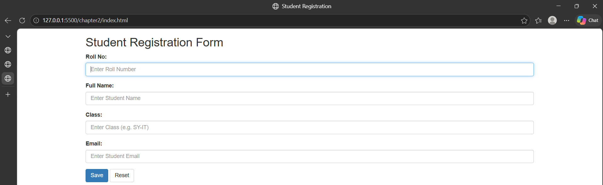
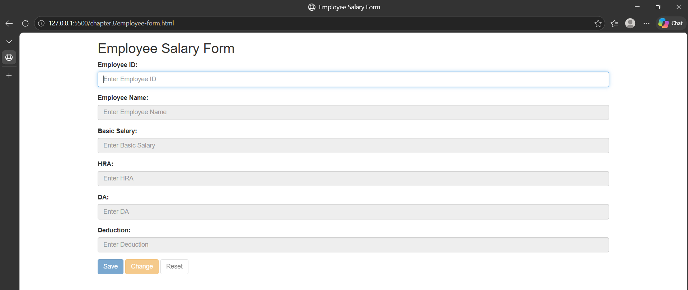
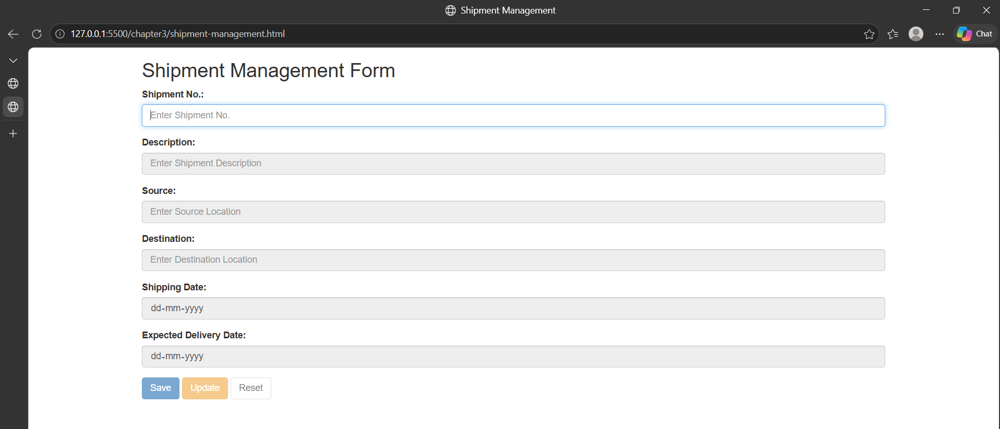

# JsonPowerDB Course Project

> Practice project for the course **Introduction to JsonPowerDB - V2.0** by Login2Xplore

## Table of Contents
- [Description](#description)
- [Benefits of using JsonPowerDB](#benefits-of-using-jsonpowerdb)
- [Scope of Functionalities](#scope-of-functionalities)
- [Illustrations](#illustrations)
- [Examples of Use](#examples-of-use)
- [Project Structure](#project-structure)
- [How to Run](#how-to-run)
- [Project Status](#project-status)
- [Release History](#release-history)
- [Sources](#sources)
- [Other Information](#other-information)

## Description
This project is a collection of the work I did while studying JsonPowerDB (JPDB),
a real-time, lightweight, REST API based multi-mode database. It contains:

- JPDB commands (IML and IRL) that I practised using Talend API Tester
- A student registration form that saves data to JPDB using AJAX
- An Employee form and a Shipment Management form, each with Save, Update/Change
  and Reset buttons, where the first field behaves like a primary key

The web pages are built with HTML, JavaScript, jQuery and Bootstrap, and talk
to JPDB directly through its REST API, with no separate backend server.

## Benefits of using JsonPowerDB
- **Schema-free:** data can be saved without designing tables first
- **Simple REST API:** every command is a JSON request and the response is JSON
- **Fast retrieval:** built on the PowerIndeX indexing engine
- **Serverless:** web pages can call the database directly
- **Multi-mode:** supports JSON document, RDBMS, key-value, geospatial and time series use
- **Faster development:** less setup code, which lowers development cost

## Scope of Functionalities
| Chapter   | What it covers                                             |
|-----------|------------------------------------------------------------|
| Chapter 1 | PUT, GET, UPDATE and REMOVE commands                       |
| Chapter 2 | Student registration form using AJAX and `jpdb-commons.js` |
| Chapter 3 | PUT_ALL, GET_BY_KEY, GET_BY_RECORD, GET_ALL, FIND_ALL_RECORDS, FIRST/LAST/NEXT/PREV_RECORD, column and database information commands, SYNC_DB, Employee form, Shipment Management form   |

Form behaviour in Chapter 3:
- On page load and after every button click, only the primary key field is active
- If the key is not found, Save and Reset are enabled
- If the key is found, the data is shown, the key is locked, and Update/Change and Reset are enabled
- No empty fields are accepted

## Illustrations




## Examples of Use
- Student registration and record keeping
- Employee salary records
- Shipment tracking for a delivery company
- The same pattern works for any form-based data entry app (library, inventory, bookings)

## Project Structure
```
JsonPowerDB-Course-Project/
├── README.md
├── images/
├── chapter1/
│   └── chapter1-commands.jsonc
├── chapter2/
│   └── index.html
└── chapter3/
    ├── chapter3-commands.jsonc
    ├── employee-form.html
    └── shipment-management.html
```

## How to Run
1. Get a free connection token from the JPDB developer dashboard
   (http://api.login2explore.com:5577/user/index.html, then Tools, then Tokens).
2. Replace the token in the code with your own.
3. For the commands, copy one into Talend API Tester (remove the `//` comments first)
   and POST it to `http://api.login2explore.com:5577/api/iml` or `/api/irl`.
4. For the forms, open the HTML file in a browser. The page must be opened over
   `http`, not `https`, because the JPDB API URL is plain `http`.

## Project Status
Completed. All course chapters up to the micro project are done. Further
improvements (such as a Delete button and a record list) could be added later.

## Release History
| Version | Date       | Description                                             |
|---------|------------|---------------------------------------------------------|
| v1.0    | 12-11-2026 | Chapter 1: basic PUT, GET, UPDATE, REMOVE commands      |
| v1.1    | 12-11-2026 | Chapter 2: student registration form                    |
| v1.2    | 12-11-2026 | Chapter 3: practice commands and Employee form          |
| v1.3    | 12-11-2026 | Chapter 3: Shipment Management micro project and README |

## Sources
- Introduction to JsonPowerDB - V2.0, Login2Xplore course
- JPDB Command Reference: https://login2explore.com/jpdb/docs.html
- JsonPowerDB home: https://login2explore.com/jpdb/

## Other Information
- **Author:** Jyoti, BVCOEW , TE-CS
- **Tech stack:** HTML, JavaScript, jQuery, Bootstrap 3, JsonPowerDB
- **Tools used:** Talend API Tester, VS, Git and GitHub